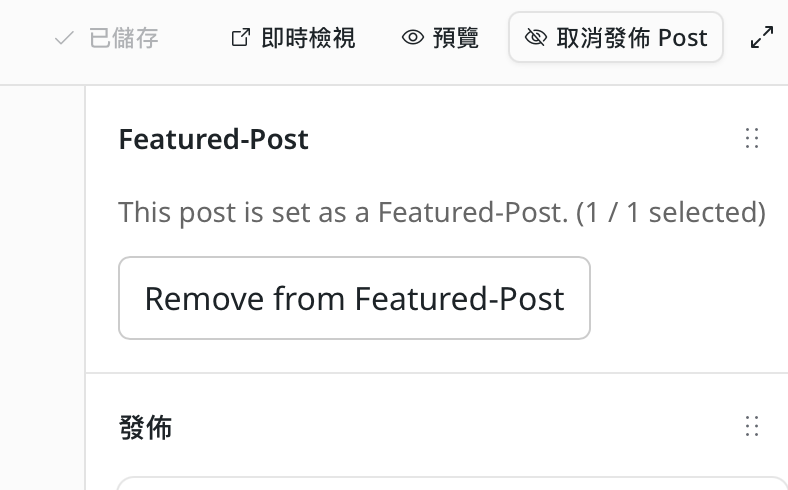
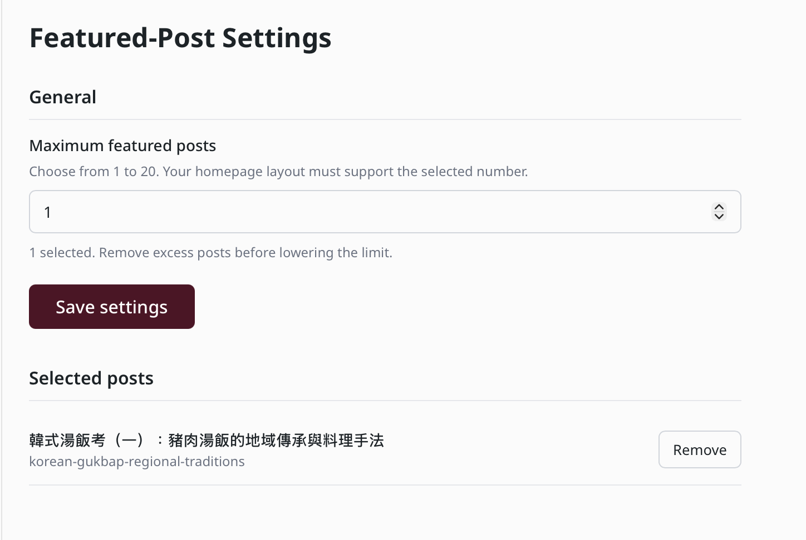
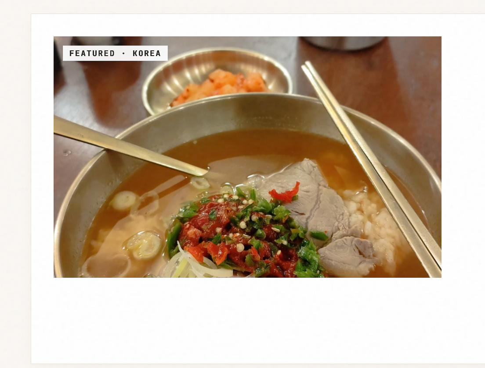

# EmDash Featured Post

English | [繁體中文](README.zh-TW.md) | [日本語](README.ja.md)

An EmDash **native plugin** for choosing one or more featured posts on your homepage. The selection control appears in an expanded section of an existing post's editor. A site administrator can choose a limit from 1 to 20; once full, remove an existing selection before adding another. Clearing all selections lets your homepage use its own fallback.


## Screenshots

**Post editor** — select or remove a featured post.



**Settings** — set the maximum and manage selected posts.



**Homepage example** — this layout is specific to the example site. The plugin does not create a homepage layout; integrate it with your own theme.



## Compatibility and requirements

- Tested with EmDash and `@emdash-cms/admin` **1.3.1**, Astro, React and Cloudflare Workers.
- This is a trusted native plugin, not a sandboxed plugin. Install it as a site dependency; it cannot be installed from the EmDash sandboxed-plugin registry.
- The examples assume the collection slug is `posts`, the image field is `featured_image`, and post URLs use `/posts/<slug>`. Adapt the homepage code to your site's schema and routes.
- The editor panel appears after an entry has been saved. Only published posts can be selected. The operation is saved immediately, independently of the article Save button.
- The plugin stores selected post IDs and slugs in plugin settings; it does not modify article content. If a selected post is unpublished, deleted, or its slug changes, the example skips unavailable selections and falls back to the latest post with an image when none remain. After changing a slug, select the post again.

## Access and trust

The plugin declares `content:read` to look up posts. Its selection route requires the caller to have the EmDash `content:publish_any` permission, and the selected post is stored in the plugin's settings. It does not use content-writing APIs to edit posts.

This is trusted native code running inside the site process, with the authority of a site dependency. The declared capability describes the EmDash context API used by this implementation; it is **not a sandbox security boundary**. Review the code and only install native plugins you trust.

## Installation

Install from this GitHub repository in your EmDash site (this project is not currently published to npm):

```sh
npm install github:joyce5438/emdash-Featured-Post
```

Add the descriptor to your existing EmDash `plugins` array in `astro.config.mjs`, preserving your existing configuration:

```js
import { featuredPostPlugin } from "emdash-featured-post";

// Inside emdash({ ... }):
plugins: [
  featuredPostPlugin(),
  // ...your other plugins
],
```

Rebuild and deploy your site. The editor panel alone does **not** alter your homepage: integrate the selected post as described below.

## Settings

Open **Featured-Post** in the EmDash plugin menu and set the maximum to an integer from 1 to 20 (default: 1). The site template determines the actual layout and must be updated to render multiple entries. If reducing the limit below the number already selected, remove enough selected posts first.

The settings page lists selected article titles and slugs and allows removal, including when a post has been deleted. Selection is saved as soon as you use the editor control; homepage caches are unaffected.

**Upgrading from 0.1:** update the homepage integration to read the new `state` setting and fall back to the old `selected` setting only when `state` does not exist. The old selection is retained, but a homepage that keeps reading only `selected` will not reflect subsequent changes. See the example below.

## Homepage integration

Use `getPluginSettings("home-featured")` to read `state.selected` and `state.limit`, retrieve each published entry with `getEmDashEntry`, verify its ID, then render the entries in your featured area. For upgrades from version 0.1, read the legacy `selected` value when `state` is absent. If no valid selection exists, fall back to your existing automatic selection. Filter the featured entry from your ordinary post grid to avoid duplication. See [examples/homepage.astro](examples/homepage.astro) for a small complete example; adapt its rendering and paths to your theme. Do not replace an existing homepage wholesale.

## Cache and usage

**The plugin does not change or disable homepage caching.** With an existing page cache, visitors may continue to see the previous featured post until that cache expires or is invalidated. A site-specific targeted cache purge after a selection change can be used where supported.

If immediate updates are required, the site owner may choose to disable page caching for the homepage. This increases Worker requests and database reads compared with the same site using a cached homepage, and can increase usage or costs. Review your host's current quotas before changing cache settings. This choice is optional and must be implemented in the site's own cache configuration.

## License

MIT. See [LICENSE](LICENSE).
